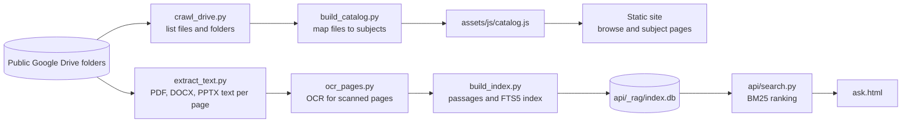

<div align="center">

# ScholarSpace

**Free notes, previous year papers and practice sets for university students, with full-text search inside every file.**

### [Live demo → scholarspace-main.vercel.app](https://scholarspace-main.vercel.app)


[Report a bug](https://github.com/Rahul-web01/Scholarspace-main/issues) · [Request a feature](https://github.com/Rahul-web01/Scholarspace-main/issues)

</div>

---

## What it does

Study material at most colleges lives in scattered WhatsApp groups and private drives. ScholarSpace puts it in one
place, organised by college, course, year and subject, and lets students search *inside* the files, including scanned
and handwritten pages.

- **800+ files across 120+ subjects**: notes, previous year question papers (PYQs), practice sets, books and syllabus PDFs.
- **B.Tech CSE, kept separate per college**, because syllabi and exams differ:
  - **BBD University**, matched to the 2026-27 syllabus.
  - **ITM College (AKTU)**, with AKTU-syllabus notes.
- **BBA (BBD University)**, matched to the 2023-24 NEP syllabus.
- **Other courses**: Mechanical, Electrical and Civil subjects, B.Pharm, Agriculture and official syllabus PDFs.

No sign-in, no ads, no paid APIs.

## Features

| Feature | Details |
| :--- | :--- |
| **Ask Notes** | Full-text search inside every note and paper. Shows the key sentences and the exact passages that match, with a link to the file and page. Can be limited to one subject. |
| **Scanned pages included** | Pages without a text layer are read with free, offline OCR (RapidOCR / PaddleOCR models), so handwritten notes are searchable too. |
| **Instant subject search** | Search every subject and file from the home page; press <kbd>/</kbd> to focus, arrow keys and <kbd>Enter</kbd> to pick. |
| **College and year browsing** | Pick a college and year to see only the subjects you study. |
| **Files grouped by type** | Each subject page splits Notes, PYQs, Practice and Books, with a filter box. |
| **View or download** | Files open in Google Drive's viewer or download in one click. |
| **SGPA calculator** | Add subjects, credits and marks; SGPA and grades update live on the 10-point scale. |
| **Light and dark mode** | Follows the system theme, with a toggle that is remembered. |
| **Self-updating** | A nightly GitHub Actions job picks up new Drive files, reads them and rebuilds the search index. |

## How it works

The site is plain HTML, CSS and JavaScript with no build step. All study files live in public Google Drive folders.
Two offline pipelines turn those folders into a static catalog and a search index, and one small Python function
answers searches.



### The search pipeline

**1. Extract.** [`tools/rag/extract_text.py`](scholarspace%20main/tools/rag/extract_text.py) reads every published
PDF (with `pdftotext`), Word and PowerPoint file page by page, plus approved student uploads.
[`tools/rag/ocr_pages.py`](scholarspace%20main/tools/rag/ocr_pages.py) renders pages that have no text and reads them
with RapidOCR (`--gpu` for an NVIDIA card). It can be stopped and resumed at any time. All extracted text is stored
gzip-compressed in `tools/rag/text/` by [`text_store.py`](scholarspace%20main/tools/rag/text_store.py), so no file is
read twice.

**2. Index.** [`tools/rag/build_index.py`](scholarspace%20main/tools/rag/build_index.py) drops cover pages and pages
that are mostly OCR noise (checked against an English word list plus words that recur across files), splits the rest
into ~1,000-character passages at sentence boundaries and writes them to SQLite:

- `files`: one row per file (subject, course, title, kind)
- `chunks`: zlib-compressed passage text, page number and an OCR flag
- `chunks_fts`: an **FTS5** virtual table over passage text and file/subject names, using the `porter unicode61` tokenizer

**3. Rank.** [`api/search.py`](scholarspace%20main/api/search.py) is a Vercel Python function that uses only the
standard library. For each query it:

1. removes stop words and keeps up to 16 terms;
2. finds candidate passages with FTS5 and ranks them by **BM25** (`bm25(chunks_fts, 1.0, 0.75)`, so passage text
   counts more than file names);
3. down-weights syllabus pages, and question papers unless the query asks for papers or PYQs;
4. keeps at most two passages per file and six results in total;
5. scores each sentence by matched terms (with a bonus for definitions) to build a snippet and up to four
   "key points", preferring typed text over OCR text.

If the runtime's SQLite lacks FTS5, it falls back to an in-memory TF-IDF scan. Identical searches are cached by
Vercel for a day.

### Automatic updates

[`.github/workflows/update-notes.yml`](.github/workflows/update-notes.yml) runs every night at 02:00 IST and on demand
(**Actions → Update notes and search → Run workflow**). It re-crawls both Drive folders, rebuilds the catalog, extracts
and OCRs anything new, rebuilds the index and pushes the result, which triggers a Vercel redeploy. Files in Drive
folders that are not yet mapped to a subject are listed in the run summary.

## Tech stack

| Layer | Technology |
| :--- | :--- |
| Frontend | HTML, CSS, vanilla JavaScript (no framework, no build step) |
| Search API | Python 3 standard library, SQLite FTS5, BM25 |
| Text extraction | `pdftotext` (poppler-utils), Python `zipfile` for DOCX/PPTX |
| OCR | RapidOCR with ONNX Runtime (CPU or NVIDIA GPU) |
| Storage | Google Drive (files), SQLite (search index) |
| Automation | GitHub Actions (nightly) |
| Hosting | Vercel (static site and Python serverless function) |
| Uploads (optional) | Google Apps Script |

## Project structure

```text
scholarspace main/
├── index.html, browse.html, subject.html   Home, course/year listing, one subject's files
├── ask.html                                Ask Notes (full-text search)
├── sgpa.html, about.html, feedback.html    SGPA calculator, about, contribute/feedback
├── assets/js/app.js                        Layout, search and page rendering
├── assets/js/catalog.js                    Generated: every subject and file
├── assets/js/config.js                     Site settings (uploads web app URL)
├── api/search.py                           Search function (Vercel)
├── api/_rag/index.db                       Generated SQLite FTS5 index
├── tools/crawl_drive.py                    Public Drive folder crawler
├── tools/build_catalog.py                  Maps Drive files to subjects (SUBJECTS list)
├── tools/rag/                              Text extraction, OCR, text store, index builder
├── tools/uploads/                          Apps Script for moderated student uploads
└── vercel.json                             Clean URLs, redirects, function config
```

## Getting started

### Run the site locally

```bash
git clone https://github.com/Rahul-web01/Scholarspace-main.git
cd "Scholarspace-main/scholarspace main"
python3 -m http.server 8000
```

Open http://localhost:8000. Browsing, subject pages and the SGPA calculator work this way.

Ask Notes calls `/api/search`, a Vercel Python function, so it does not run under `http.server`. To try it locally,
run `vercel dev` from the same folder with the [Vercel CLI](https://vercel.com/docs/cli).

### Add new study material

1. Upload the files to the public Drive folder.
2. Refresh the file lists and rebuild the catalog:

   ```bash
   cd "scholarspace main"
   python3 tools/crawl_drive.py 1KDEa-DkdkNl6FuhUDO9upWKTaSeQlRNC tools/drive-tree.tsv
   python3 tools/crawl_drive.py 1GhW9UVlo35eLvbHPEsSv4NiCul0hkml6 tools/bba-drive-tree.tsv
   python3 tools/build_catalog.py
   ```

3. If the script prints `NOT LINKED:` lines, add those files or folders to a subject in `SUBJECTS` in
   `tools/build_catalog.py` (BBD University subjects use program `B`, ITM College subjects use `I`) and run it again.
   Optionally add a clean title in `tools/titles.tsv`.
4. Commit and push. The nightly workflow reads the new files and updates search.

### Rebuild the search index by hand

Needs Python 3, `poppler-utils` (for `pdftotext` and `pdfinfo`) and, for OCR,
`pip install rapidocr onnxruntime opencv-python-headless`.

```bash
cd "scholarspace main"
python3 tools/rag/text_store.py unpack
python3 tools/rag/extract_text.py
python3 tools/rag/ocr_pages.py            # add --gpu with onnxruntime-gpu installed
python3 tools/rag/text_store.py pack
python3 tools/rag/build_index.py
```

`extract_text.py` reads local copies of the Drive folders if `SS_DATA_ROOT` / `SS_BBA_ROOT` point to them, and
otherwise downloads each file from its public Drive link.

### Student uploads (optional)

The Contribute page can send files to a Google Apps Script web app
([`tools/uploads/Code.gs`](scholarspace%20main/tools/uploads/Code.gs)) running in the owner's Google account. Files stay
private until the owner approves them on a review page. Until the web app URL is set in `assets/js/config.js`, the
Contribute page falls back to email. Setup steps: [`tools/uploads/README.md`](scholarspace%20main/tools/uploads/README.md).

## Roadmap

- Year-wise pages for more programmes (B.Pharm, other B.Tech branches)
- Bookmarks for favourite subjects

## Author

**Rahul Singh**, final-year B.Tech CSE student at BBD University, Lucknow

[](https://github.com/Rahul-web01)
[](https://www.linkedin.com/in/rahul-singh-cs/)
[](mailto:contact.rahul82@gmail.com)

---

<div align="center">

If you found this useful, consider giving it a ⭐

</div>
